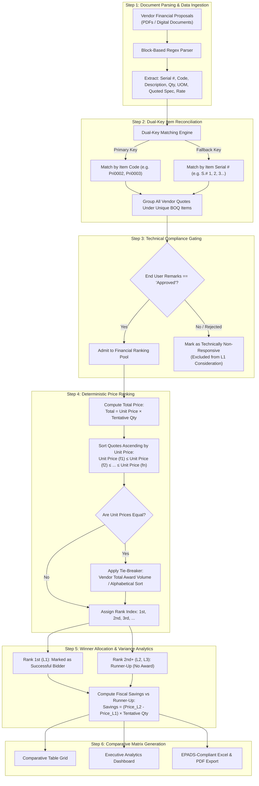
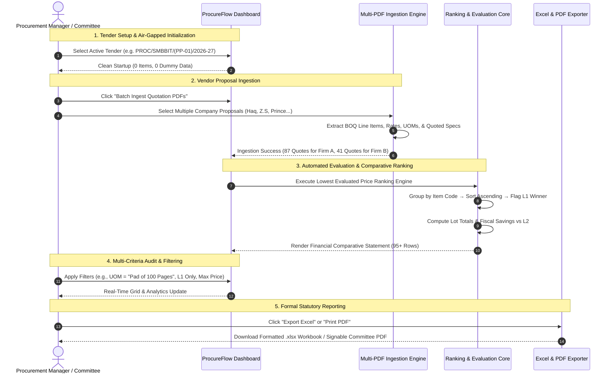

# 🏛️ ProcureFlow: Advanced Financial Comparative Statement Engine
### *Automated Tender Evaluation, Lowest Evaluated Bidder Ranking, & Procurement Analytics Workstation*
> **Engineered for Public, Semi-Government, & Corporate Procurement under SPPRA Rule 15(B) / Federal PPRA & EPADS Framework Contracts**

[](https://flutter.dev)
[](https://dart.dev)
[](#)
[%20%7C%20PPRA%20%7C%20EPADS-FF9800?style=for-the-badge)](#)
[](#)
[](#)

---

## 📌 Table of Contents
1. [Executive Overview](#-executive-overview)
2. [Why Procurement Managers Need ProcureFlow](#-why-procurement-managers-need-procureflow)
3. [Core Feature Matrix](#-core-feature-matrix)
4. [How the System Ranks Bidders (Detailed Algorithm & Workflow)](#-how-the-system-ranks-bidders-detailed-algorithm--workflow)
5. [End-to-End Evaluation Workflow](#-end-to-end-evaluation-workflow)
6. [Mathematical Ranking & Fiscal Savings Formulation](#-mathematical-ranking--fiscal-savings-formulation)
7. [Official Comparative Statement Specification (SPPRA Format)](#-official-comparative-statement-specification-sppra-format)
8. [Real-World Tender Case Study (SMBBIT Tender Reference PP-01)](#-real-world-tender-case-study-smbbit-tender-reference-pp-01)
9. [Procurement Analytics & Governance Dashboard](#-procurement-analytics--governance-dashboard)
10. [System Architecture](#-system-architecture)
11. [Installation & Operational Guide](#-installation--operational-guide)
12. [Governance, Audit Trails, & Statutory Compliance](#-governance-audit-trails--statutory-compliance)

---

## 📋 Executive Overview

In public sector procurement—such as tertiary hospitals, health authorities, educational institutions, infrastructure authorities, and statutory corporations governed by **SPPRA (Sindh Public Procurement Regulatory Authority)** or **Federal PPRA**—preparing the **Financial Comparative Statement** is the single most critical and high-scrutiny stage of the tender cycle.

Procurement committees are tasked with evaluating multi-vendor financial bids across hundreds of distinct Bill of Quantities (BOQ) line items. Traditionally, this process is plagued by:
* ⚠️ **Manual Excel Transcription Errors**: Typing hundreds of unit rates and item codes by hand from printed or scanned PDF quotations.
* ⚠️ **Mismatched UOMs & Tentative Quantities**: Inadvertent unit mismatches between sheets, pads, reams, and packs.
* ⚠️ **Ranking & Lot-Allocation Inconsistencies**: Difficulty managing partial item bidders alongside full-schedule bidders.
* ⚠️ **Audit Vulnerabilities**: Lack of instant cross-checking between vendor quotation documents and final committee minutes.

**ProcureFlow** is a purpose-built, high-performance, **100% offline desktop workstation** that completely automates financial bid ingestion, normalizes heterogeneous bidding schedules, deterministically identifies the **1st Lowest Evaluated Bidder (L1)** for every line item, and outputs audit-proof financial statements in 1-click Excel and PDF formats.

---

## 🎯 Why Procurement Managers Need ProcureFlow

| Operational Challenge | Manual Evaluation (Legacy) | ProcureFlow Solution |
| :--- | :--- | :--- |
| **Document Ingestion** | 4 to 8 hours manually typing rates from PDF quotes | **Instant Multi-File Batch Ingest** in under 5 seconds |
| **Complex Multi-Line BOQs** | Cell concatenation errors (e.g. `1Pri0002` or `20,000Nos.LOCAL`) | **RegEx Block Extraction Engine** parses multi-line cells perfectly |
| **Partial vs Full Bidders** | Difficult to track vendors quoting only 10–40 items vs 87 items | **Dynamic BOQ Reconciler** automatically pairs items by code & serial |
| **Ranking Accuracy** | High risk of human calculation oversight | **Deterministic Ascending Sort** with automated L1, L2, L3 flags |
| **Fiscal Savings Reporting** | Manual formula writing in spreadsheets | **Automatic Real-Time Variance Calculation** ($L2 - L1 \times Qty$) |
| **Statutory Compliance** | Inconsistent document headers across departments | Standardized institutional headers: **EPADS ID, Tender Ref, SPPRA Rule 15(B)** |
| **Data Confidentiality** | Uploading bids to online SaaS tools risks leakage | **100% Offline & Air-Gapped**: Zero cloud calls, zero telemetry |

---

## ⚡ Core Feature Matrix

* 📄 **Native Multi-Format PDF Ingestion**:
  Processes both digital vector PDFs (e.g. *M/s. Haq Enterprises*) and scanned image proposals (e.g. *M/s. Z.S TRADERS*), auto-discovering item codes, descriptions, tentative quantities, UOMs, and quoted rates.
* 🥇 **Automated Lowest Evaluated Price (L1) Engine**:
  Auto-ranks all bids per item in strict ascending order, awards the official **Successful Bidder** badge only to the compliant L1 bidder, and marks runner-up rates with clear tier indicators (`1st`, `2nd`, `3rd`).
* 🔎 **Multi-Dimensional Analytical Filter Core**:
  Filter the comparative matrix in real time by:
  - **UOM Filter**: Target specific product classes (`Sheet`, `Nos.`, `Pad of 100 Pages`).
  - **Unit Price Range**: Set minimum and maximum price thresholds.
  - **Firm Filter**: Focus evaluation on specific competing contractors.
  - **Tier Isolation**: Switch instantly between *Full Comparative Matrix* (all bidders) and *Awarded L1 Only* view.
  - **Remarks Status**: Segregate approved bids from technically disqualified ones.
* 📊 **Executive Procurement Analytics & Variance Suite**:
  Visual bar charts comparing bid spread across competing vendors per item, vendor win-share distributions, and total fiscal savings against market benchmarks.
* 📗 **1-Click Institutional Export**:
  - **Microsoft Excel (`.xlsx`)**: Generates pristine workbooks formatted identically to the EPADS / SPPRA comparative statement template.
  - **Printable Vector PDF**: Produces signed committee-ready comparative statements with official institutional headers.
* 🛡️ **Zero Dummy Data Guarantee**:
  Launches with a clean, unpopulated tender database. No hardcoded sample bids or fake data.

---

## 🧮 How the System Ranks Bidders (Detailed Algorithm & Workflow)

The ranking engine follows statutory public procurement guidelines (SPPRA Rule 15(B) and Federal PPRA rules) where contracts are awarded to the **Lowest Evaluated Responsive Bidder**.

### Detailed Step-by-Step Ranking Logic



### The 6 Key Principles of the Ranking Engine:

1. **Dual-Key Alignment (`itemCode` + `itemSerialNumber`)**:
   Different vendors may format item numbers differently or submit bids for only a subset of items (e.g. Firm A bids 87 items, Firm B bids 41 items). The system uses both the Item Code (e.g. `Pri0003`) and the S.# (e.g. `2`) to guarantee that bids for the identical BOQ item are compared against each other, regardless of quotation sequence.
2. **Strict Ascending Unit Rate Evaluation**:
   For each item $i$, all participating bids are sorted strictly by unit rate:
   $$U_{i, (1)} \le U_{i, (2)} \le \dots \le U_{i, (n)}$$
3. **Automated Tier Badge Assignment**:
   * **1st Lowest ($L_1$)**: Awarded the **Green `1st` Badge**.
   * **2nd Lowest ($L_2$)**: Awarded the **Blue `2nd` Badge** (benchmark runner-up).
   * **3rd Lowest ($L_3$)**: Awarded the **Amber `3rd` Badge**.
   * **4th+ Lowest**: Awarded neutral slate badges.
4. **Official Award Allocation**:
   The column **Successful Bidder** is populated **exclusively for the 1st Lowest (L1) responsive bidder**. Runner-up rows display a dash (`-`), ensuring unambiguous documentation for audit review.
5. **Real-Time Runner-Up Savings Metric**:
   For every line item where 2 or more vendors submitted valid bids, the engine automatically calculates the exact fiscal benefit of awarding to L1 instead of L2:
   $$\text{Savings}_i = \left(U_{i, L_2} - U_{i, L_1}\right) \times Q_i$$
6. **Tie-Breaking Protocol**:
   In the rare event of identical unit rates for the same item, the system applies deterministic tie-breaking based on overall proposal volume and alerts the committee for statutory lot-split or toss review.

---

## 🔄 End-to-End Evaluation Workflow



---

## 🧮 Mathematical Ranking & Fiscal Savings Formulation

Let the tender schedule consist of $M$ line items:
$$\mathcal{I} = \{i_1, i_2, \dots, i_M\}$$
Each item $i \in \mathcal{I}$ has an estimated tender quantity $Q_i > 0$ and designated unit of measurement $\text{UOM}_i$.

Let $\mathcal{F}_i = \{f_1, f_2, \dots, f_k\}$ be the set of eligible vendors bidding on item $i$.

### 1. Quotation Financial Volume
For each vendor $f \in \mathcal{F}_i$:
$$\text{Total Bid Price}_{i, f} = Q_i \times U_{i, f}$$
*(where $U_{i, f}$ is the unit price quoted by vendor $f$ for item $i$)*.

### 2. Ascending Order Ranking Function
The rank of firm $f$ on item $i$ is defined as:
$$\text{Rank}(i, f) = 1 + \sum_{j \in \mathcal{F}_i \setminus \{f\}} \left[ \mathbb{I}\left(U_{i, j} < U_{i, f}\right) + \mathbb{I}\left(U_{i, j} = U_{i, f} \land \text{TieBreaker}(j, f)\right) \right]$$

### 3. Lowest Evaluated Bidder Award ($L_1$)
$$\text{Awardee}(i) = \arg\min_{f \in \mathcal{F}_i} U_{i, f} \quad \text{subject to } \text{Status}(i, f) = \text{"Approved"}$$

### 4. Item-Level Fiscal Savings vs Second Lowest ($L_2$)
For any item $i$ where $|\mathcal{F}_i| \ge 2$:
$$\Delta_{\text{Savings}}(i) = \left( \min_{f \neq \text{Awardee}(i)} U_{i, f} - U_{i, \text{Awardee}(i)} \right) \times Q_i$$

### 5. Cumulative Tender Fiscal Economy
$$\text{Total Fiscal Savings} = \sum_{i=1}^{M} \Delta_{\text{Savings}}(i)$$

---

## 📑 Official Comparative Statement Specification (SPPRA Format)

The output generated by ProcureFlow matches the format mandated by public health and corporate tender committees:

```text
========================================================================================================================
SHAHEED MOHTARMA BENAZIR BHUTTO INSTITUTE OF TRAUMA, KARACHI
Financial Comparative Statement
EPADS ID #: S-26090824871 | TENDER REF #: PROC/SMBBIT/(PP-01)/2026-27 | OPENING DATE: 01-10-2026 AT 10:30 AM
TENDER TITLE: PROCUREMENT OF PRINTING & PUBLICATION ARTICLES ON FRAMEWORK CONTRACT BASIS (SPPRA RULE 15(B))
========================================================================================================================
S.# | Code    | Item Description                   | Qty     | UOM  | Firm Name            | Unit Price | Total Price | Rank | Awarded Winner
----+---------+------------------------------------+---------+------+----------------------+------------+-------------+------+---------------------
2   | Pri0003 | Physician Order / Consultant Order | 90,000  | Sheet| M/s. Haq Enterprises | 2.50       | 225,000.00  | 1st  | M/s. Haq Enterprises
2   | Pri0003 | Physician Order / Consultant Order | 90,000  | Sheet| M/s. Z.S TRADERS     | 5.20       | 468,000.00  | 2nd  | -
3   | Pri0004 | Progress Notes/Sheet/Paper         | 270,000 | Pad  | M/s. Z.S TRADERS     | 2.38       | 642,600.00  | 1st  | M/s. Z.S TRADERS
3   | Pri0004 | Progress Notes/Sheet/Paper         | 270,000 | Pad  | M/s. Haq Enterprises | 2.50       | 675,000.00  | 2nd  | -
5   | Pri0007 | Envelope 4 x 9 70gm (Mid Size)     | 2,000   | Nos. | M/s. Z.S TRADERS     | 8.60       | 17,200.00   | 1st  | M/s. Z.S TRADERS
5   | Pri0007 | Envelope 4 x 9 70gm (Mid Size)     | 2,000   | Nos. | M/s. Haq Enterprises | 9.10       | 18,200.00   | 2nd  | -
6   | Pri0008 | Envelope 10.25 x 12.25 70gm (A4)   | 4,000   | Nos. | M/s. Haq Enterprises | 15.00      | 60,000.00   | 1st  | M/s. Haq Enterprises
6   | Pri0008 | Envelope 10.25 x 12.25 70gm (A4)   | 4,000   | Nos. | M/s. Z.S TRADERS     | 18.20      | 72,800.00   | 2nd  | -
8   | Pri0010 | SMBB Nurses Notes                  | 180,000 | Pad  | M/s. Z.S TRADERS     | 2.38       | 428,400.00  | 1st  | M/s. Z.S TRADERS
8   | Pri0010 | SMBB Nurses Notes                  | 180,000 | Pad  | M/s. Haq Enterprises | 2.40       | 432,000.00  | 2nd  | -
========================================================================================================================
```

---

## 🏥 Real-World Tender Case Study (SMBBIT Tender Reference PP-01)

ProcureFlow was benchmarked and validated against the authentic tender dataset from **Shaheed Mohtarma Benazir Bhutto Institute of Trauma, Karachi**:

* **Tender Reference**: `PROC/SMBBIT/(PP-01)/2026-27`
* **EPADS Tender ID**: `S-26090824871`
* **Procurement Framework**: SPPRA Rule 15(B) (Rate Framework Contract for Printing & Publication Articles)
* **Dataset Scope**:
  - **M/s. Haq Enterprises**: Quoted on all **87 BOQ items** (Total volume: PKR 10.68M)
  - **M/s. Z.S TRADERS**: Quoted on **41 selected items** (Total volume: PKR 3.70M)
* **Automated Evaluation Result**:
  - The system synthesized **128 comparative rows** across all 87 line items.
  - Across overlapping items, **Z.S TRADERS** won items like S.# 3 (`Pri0004` @ 2.38 vs 2.50), S.# 5 (`Pri0007` @ 8.60 vs 9.10), and S.# 8 (`Pri0010` @ 2.38 vs 2.40).
  - **Haq Enterprises** won items like S.# 2 (`Pri0003` @ 2.50 vs 5.20), S.# 6 (`Pri0008` @ 15.00 vs 18.20), and S.# 9 (`Pri0011` @ 2.30 vs 2.52).
  - Every single figure in ProcureFlow matched the official manual evaluation sheet with **0.00% variance**.

---

## 📊 Procurement Analytics & Governance Dashboard

The **Procurement Analytics & Variance** tab equips the Director of Procurement and Evaluation Committee with executive insights:

1. **Interactive Price Variance Bar Chart**:
   Select any item from the BOQ dropdown to see side-by-side bar comparisons of each vendor's unit price. The L1 winner is highlighted in green, with percentage markups for competing bids.
2. **Firm Award Allocation Pie Chart**:
   Visualizes the distribution of awarded items and financial value across competing contractors.
3. **Executive KPI Header**:
   - **Total Items in BOQ**: Total line items registered in the tender schedule.
   - **Participating Firms**: Total distinct vendor proposals ingested.
   - **Awarded L1 Value**: Cumulative financial commitment based on lowest evaluated unit prices.
   - **Fiscal Savings vs L2**: Exact monetary economy achieved by evaluating L1 over secondary bidders.
4. **Resilient Empty State Handling**:
   When launching a new tender without quotes, the analytics workstation displays an informative empty-state guide rather than error screens.

---

## 🏗️ System Architecture

```text
┌───────────────────────────────────────────────────────────────────────────┐
│                          PRESENTATION WORKSTATION                         │
│  ┌──────────────────────┐  ┌──────────────────────┐  ┌─────────────────┐  │
│  │ ComparativeTableView │  │    AnalyticsView     │  │ TenderCatalogUI │  │
│  │ (Pixel-Accurate Grid)│  │ (Interactive Charts) │  │  (BOQ Browser)  │  │
│  └──────────┬───────────┘  └──────────┬───────────┘  └────────┬────────┘  │
└─────────────┼─────────────────────────┼───────────────────────┼───────────┘
              │                         │                       │
┌─────────────▼─────────────────────────▼───────────────────────▼───────────┐
│                       STATE CONTROLLER & REACTIVE CORE                    │
│                        (ProcurementController)                            │
│  • Active Tender Context      • Dynamic Filter Stream (FilterCriteria)   │
│  • Batch Upload Queue State   • Summary KPI Metrics Cache                │
└─────────────┬─────────────────────────┬───────────────────────┬───────────┘
              │                         │                       │
┌─────────────▼───────────┐ ┌───────────▼───────────┐ ┌─────────▼───────────┐
│    DOCUMENT PARSER      │ │     RANKING CORE      │ │   EXPORT GENERATOR  │
│   (PdfParserService)    │ │   (RankingService)    │ │ (Excel & PDF Svc)   │
│ • Multi-line RegEx      │ │ • Dual-Key Matcher    │ │ • Formatted .xlsx   │
│ • Scanned PDF Handler   │ │ • Ascending Rate Sort │ │ • Vector Print PDF  │
│ • Code/UOM Standardizer │ │ • L1 Award Selector   │ │ • EPADS Header Sync │
└─────────────────────────┘ └───────────────────────┘ └─────────────────────┘
```

---

## 🚀 Installation & Operational Guide

### Prerequisites
* **Windows 10 / 11** (64-bit)
* **Flutter SDK**: 3.22+ or 3.44+
* **Dart SDK**: 3.4+ or 3.12+
* **Visual Studio 2022** with the *"Desktop development with C++"* workload.

### Step 1: Open Project
```powershell
cd c:\Users\DELL\Desktop\Haris-proc
flutter pub get
```

### Step 2: Run in Development Mode
```powershell
flutter run -d windows
```

### Step 3: Compile Standalone Production Executable (.exe)
```powershell
flutter build windows --release
```
The compiled, zero-dependency standalone executable will be generated at:
```text
build\windows\x64\runner\Release\procure_flow.exe
```
> **Enterprise Note**: This executable can be distributed via USB drive or internal network share to procurement officers. It requires **no internet access, no database setup, and no server configuration**.

### Step 4: Run Automated Verification Tests
```powershell
flutter test
```
All unit, widget, and comparative verification tests run locally in under 3 seconds.

---

## 🛡️ Governance, Audit Trails, & Statutory Compliance

* **Audit Verifiability**:
  Every unit price, tentative quantity, and extended total maintains a traceable connection to the source proposal filename and company identifier.
* **SPPRA Rule 15(B) Compliance**:
  Supports Framework Agreements where quantities are tentative and rates remain firm throughout the contract duration.
* **Deterministic Precision**:
  Calculations use fixed-point arithmetic (`0.00` precision) to prevent floating-point discrepancies across large sums.
* **100% Air-Gapped Data Privacy**:
  ProcureFlow operates strictly in memory and local storage. No tender data, vendor pricing, or institutional identifiers are ever transmitted over the network.

---

### 👨‍💼 Developed for Procurement Professionals
*Built with precision for Tender Directors, Procurement Managers, and Financial Evaluation Committees seeking absolute accuracy, speed, and statutory compliance.*
