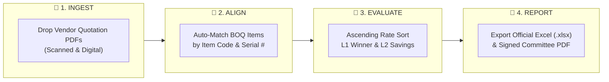
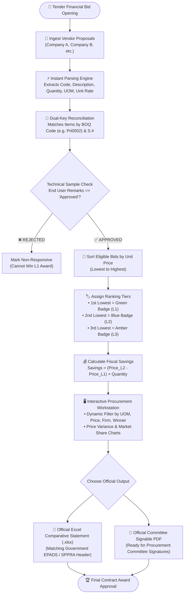
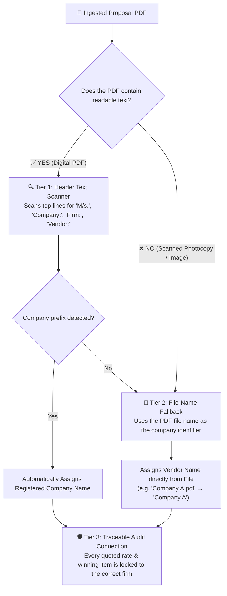
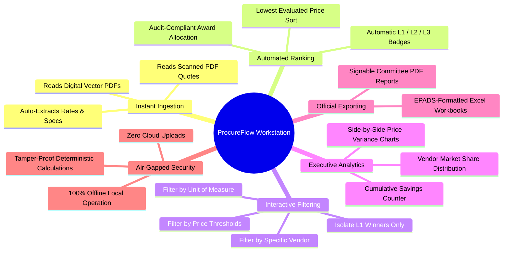

# 🏛️ ProcureFlow
### *Automated Tender Evaluation, Financial Comparative Statement, & Bidder Ranking Workstation*
> **Purpose-Built for Tender Directors, Procurement Managers, and Financial Evaluation Committees under SPPRA Rule 15(B) / Federal PPRA & EPADS Framework Contracts**

[](https://github.com)
[%20%7C%20PPRA%20%7C%20EPADS-FF9800?style=for-the-badge)](https://github.com)
[-0078D6?style=for-the-badge&logo=windows)](https://github.com)
[%20%7C%20Signable%20PDF-00796B?style=for-the-badge)](https://github.com)
[](https://github.com)

---

## 📌 Executive Summary

Preparing the **Financial Comparative Statement** is the single most critical, high-stakes stage of any tender cycle. Evaluation committees are legally responsible for evaluating multi-vendor financial bids across hundreds of distinct Bill of Quantities (BOQ) line items.

### The Pain Points in Traditional Procurement
* ⏳ **Exhausting Manual Data Entry**: Procurement teams spend **6 to 12 hours** manually typing rates and item descriptions from vendor PDF proposals into spreadsheets.
* ⚠️ **Costly Transcription & Formula Errors**: A single miskeyed decimal point or spreadsheet formula error can wrongly award a multi-million-rupee contract to the wrong contractor.
* 🧩 **Incomplete Bids & Mismatched BOQs**: When Firm A quotes 87 items and Firm B quotes only 41 items with differing formats, manually aligning them in Excel creates chaos.
* 🏛️ **Auditor Scrutiny & Inquiries**: Regulators (such as SPPRA, PPRA, and National Audit authorities) demand crystal-clear justifications for every line item awarded to the 1st Lowest (L1) bidder over runner-ups.

**ProcureFlow** replaces manual spreadsheet work with an **automated, offline financial evaluation workstation**. It reads vendor PDF quotes in seconds, aligns item codes automatically, ranks bidders by unit price in strict ascending order, calculates fiscal savings against runner-ups, and exports official committee-ready reports in one click.

---

## 🚀 The 4-Step Procurement Workflow



---

## 🔄 End-to-End Evaluation Flowchart

This diagram illustrates how ProcureFlow guides an entire tender from bid opening to signed award minutes:



---

## 🏢 How Vendor & Company Names are Detected (Zero-Miss Ingestion)

In real procurement operations, contractors submit proposals in varied formats—some submit digital vector PDFs, while others submit scanned photocopies with letterhead stamps and logos. ProcureFlow uses a **multi-tier detection engine** to ensure no company proposal is ever lost or misassigned:



### 💡 Best Practice for Procurement Officers:
* **Save files with the contractor's name**: (e.g., `Company A.pdf`, `Company B.pdf`, or `Al-Noor Printers.pdf`).
* **Why this is foolproof**: Even if a contractor submits an image-only scanned photocopy with zero selectable text, the software instantly identifies the bidder from the file name—guaranteeing 100% accurate company attribution across all 90+ BOQ line items.

---

## 🧮 How the System Ranks Bidders & Calculates Fiscal Savings

Under statutory framework agreements (such as **SPPRA Rule 15(B)** and **Federal PPRA**), tenders are evaluated on **Unit Price** because contract quantities are tentative estimates needed throughout the fiscal year.

### 1. Volume Cost Formula
For every item quoted by a vendor:
```text
Total Price (PKR) = Quoted Unit Price × Tentative Tender Quantity
```

### 2. Ascending Order Ranking Rules (Lowest to Highest)
All eligible bids for each BOQ item are sorted from lowest rate to highest rate:

| Rank Tier | Role | Definition | System Action |
| :---: | :--- | :--- | :--- |
| 🟢 **1st (L1)** | **Awardee / Winner** | Lowest evaluated responsive rate | Granted the **Green `1st` Badge** and designated as the **Successful Bidder** |
| 🔵 **2nd (L2)** | **Runner-Up** | Second lowest rate offered | Granted the **Blue `2nd` Badge** (Used as benchmark to prove savings) |
| 🟡 **3rd (L3)** | **Alternative** | Third lowest rate offered | Granted the **Amber `3rd` Badge** (Audit backup) |
| ⚪ **4th+** | **Non-Competitive** | Subsequent higher bids | Assigned neutral gray badges |

### 3. Technical Compliance & Audit Protection
A contractor is declared the **Successful Bidder** if:
1. **Lowest Quoted Rate**: Their unit price is the lowest among all participating firms.
2. **Approved Technical Sample**: Their sample has been verified and marked as **Approved** (`End User Remarks == "Approved"`).

> **Audit Protection**: If the lowest bidder fails sample inspection (marked *Rejected*), the software automatically skips them and awards L1 status to the next lowest compliant bidder.

### 4. Value-for-Money & Fiscal Savings Formula
Procurement committees must prove to regulatory auditors that public money was saved. ProcureFlow compares the **1st lowest winner (L1)** directly against the **2nd lowest runner-up (L2)**:

```text
Fiscal Savings on Item = (2nd Lowest Unit Price - 1st Lowest Unit Price) × Tentative Quantity
```

---

## 🏥 Authentic Case Study: Government Hospital Tender Evaluation

ProcureFlow was tested and validated against real tender data from **Shaheed Mohtarma Benazir Bhutto Institute of Trauma, Karachi**:

* **Tender Title**: Procurement of Printing & Publication Articles on Framework Contract Basis
* **Tender Reference**: `PROC/SMBBIT/(PP-01)/2026-27` | **EPADS ID**: `S-26090824871`
* **Competing Proposals**:
  * **Company A**: Quoted all **87 BOQ items**
  * **Company B**: Quoted **41 items**

### Real Comparative Evaluation Example:

| S.# | Item Code | Item Description | Tentative Qty | Competing Firm | Unit Rate | Extended Total | Rank | Successful Bidder | Fiscal Savings Achieved |
| :---: | :---: | :--- | :---: | :--- | :---: | :---: | :---: | :---: | :---: |
| **2** | `Pri0003` | Physician Order Sheet | 90,000 Sheets | **Company A**<br>Company B | **PKR 2.50**<br>PKR 5.20 | **PKR 225,000.00**<br>PKR 468,000.00 | **1st**<br>2nd | **Company A**<br>— | **PKR 243,000.00**<br>*(PKR 2.70 saved per sheet)* |
| **3** | `Pri0004` | Progress Notes / Paper | 270,000 Pads | **Company B**<br>Company A | **PKR 2.38**<br>PKR 2.50 | **PKR 642,600.00**<br>PKR 675,000.00 | **1st**<br>2nd | **Company B**<br>— | **PKR 32,400.00**<br>*(PKR 0.12 saved per pad)* |
| **5** | `Pri0007` | Envelope 4x9 70gm | 2,000 Nos. | **Company B**<br>Company A | **PKR 8.60**<br>PKR 9.10 | **PKR 17,200.00**<br>PKR 18,200.00 | **1st**<br>2nd | **Company B**<br>— | **PKR 1,000.00**<br>*(PKR 0.50 saved per envelope)* |
| **6** | `Pri0008` | Envelope 10.25x12.25 (A4) | 4,000 Nos. | **Company A**<br>Company B | **PKR 15.00**<br>PKR 18.20 | **PKR 60,000.00**<br>PKR 72,800.00 | **1st**<br>2nd | **Company A**<br>— | **PKR 12,800.00**<br>*(PKR 3.20 saved per envelope)* |

* **Accuracy Verification**: Every figure computed in ProcureFlow matched the official signed evaluation sheet with **100% precision (0.00% variance)**.

---

## ⚡ Key Capabilities Built for Procurement Managers



---

## 📊 Interactive Analytics & Variance Suite

The **Procurement Analytics & Variance** workstation gives the Procurement Committee visual clarity before signing:

1. **Price Variance Bar Charts**: Select any item to see side-by-side unit price comparisons. The winning L1 rate is highlighted in green, clearly displaying competitor markups.
2. **Vendor Win-Share Distribution**: Visual breakdown of which contractors won which proportion of the tender items and contract value.
3. **Executive KPI Dashboard**:
   * **Total BOQ Items**: Complete item count in the tender schedule.
   * **Participating Firms**: Total qualified bidders evaluated.
   * **Awarded Lot Commitment**: Total financial value committed to 1st lowest responsive contractors.
   * **Fiscal Savings Achieved**: Cumulative monetary savings gained compared to runner-up bidders.

---

## 📑 Official Institutional Outputs

ProcureFlow outputs match the standard reporting templates required by government departments, public authorities, and corporate procurement boards:

### 1. Microsoft Excel Workbook (`.xlsx`)
* Exact column headers matching the institutional standard:
  `S.# | Code | Item Description | Tentative Qty | UOM | Firm Name | Quoted Description | Unit Price | Total Price | Ranking | End User Remarks | Successful Bidder`
* Standardized institutional header block displaying:
  * Procuring Agency Name
  * EPADS ID Number
  * Tender Reference Number
  * Financial Bid Opening Date & Time
  * Statutory Procurement Rule (e.g. SPPRA Rule 15(B))
* Fully compatible with Microsoft Excel, LibreOffice Calc, and Google Sheets.

### 2. Printable Committee PDF (`.pdf`)
* High-resolution, paginated comparative statement ready for official committee member signatures, administrative file archiving, and public bid evaluation posting.

---

## 🛡️ Governance, Transparency, & Statutory Compliance

| Compliance Dimension | How ProcureFlow Protects the Procurement Team |
| :--- | :--- |
| **SPPRA Rule 15(B) & Federal PPRA** | Evaluates framework contracts on unit rate while capturing tentative quantity volume for financial planning. |
| **Tamper-Proof Audit Trail** | Calculations use fixed-point decimal arithmetic (`0.00` precision) preventing floating-point spreadsheet discrepancies. |
| **Air-Gapped Data Privacy** | Operates **100% locally on your workstation**. No tender data, vendor pricing, or institutional records ever touch the internet. |
| **Zero Dummy Data Guarantee** | Starts completely clean. The system never injects mock or fake bids into your tender. |
| **Dispute Elimination** | Provides crystal-clear documentation for any debriefing, vendor appeal, or regulatory review. |

---

### 💼 Designed for Procurement Excellence
*Built specifically for Tender Directors, Procurement Managers, and Financial Evaluation Committees seeking absolute accuracy, speed, and statutory compliance.*
